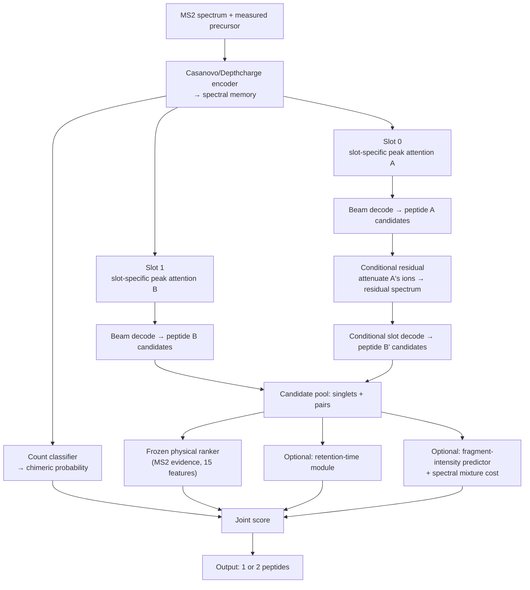

# Chimeric de novo peptide sequencing (single / double co-fragmented MS2)

A dual-slot transformer model that decodes **one or two peptides directly from
an MS2 spectrum and its measured precursor**, with two optional re-ranking
modules (retention time and fragment-intensity/spectral mixture) that can be
enabled from the command line.

## Model



Core parts: dual-slot decoding with slot-specific peak attention, a
conditional-residual branch that recovers a second peptide from the residual
spectrum, a chimeric-count classifier, and a frozen physical-feature ranker.
Only MS2 data and the measured precursor are needed.

## Reported performance (independent held-out test panel)

1024 test spectra (64 single + 64 double from each of 8 held-out test RAW
files; never used for training or checkpoint selection):

| Model | Single exact | Double exact |
|---|---:|---:|
| **Final model (default flags)** | **36.5% (187/512)** | **16.4% (84/512)** |

Known limitation: the dominant failure mode for double peptides is *candidate
generation* of the weak co-fragmenting peptide. Only ~29% of double spectra
have both true peptides present anywhere in the candidate pool, so re-ranking
modules alone cannot raise double recall beyond that ceiling.

## Installation

```bash
pip install -r requirements.txt
```

Place the released weights in `checkpoints/`:

| File | Size | Description |
|---|---|---|
| `model.pt` | ~200 MB | final sequencing model (Git LFS or GitHub Release asset) |
| `rt_model.pt` | 2 MB | retention-time predictor (optional) |
| `intensity.pt` | 0.9 MB | fragment-intensity predictor (optional) |

## Usage

Basic prediction (recommended, this is the reported final model):

```bash
python predict.py --input spectra.mgf --output predictions.csv
```

Choose the beam width (as with Casanovo's `--beam-size`):

```bash
python predict.py --input spectra.mgf --output pred.csv --beam-size 4
```

Enable the optional retention-time re-ranking:

```bash
python predict.py --input spectra.mgf --output pred.csv \
    --use-rt --rt-checkpoint checkpoints/rt_model.pt --rt-weight 1.0
```

Enable the optional fragment-intensity mixture re-ranking:

```bash
python predict.py --input spectra.mgf --output pred.csv \
    --use-intensity --intensity-checkpoint checkpoints/intensity.pt \
    --intensity-weight 2.46
```

Both can be combined. The frozen ranker was fitted for `--beam-size 4`; other
beam widths fall back to raw beam-score selection and ignore the ranker.

### Honest note on the optional modules

On the independent test panel, adding either module changes the exact-match
result only within noise (single 36.7% vs 36.5%, double 16.4% vs 16.4%). They
improve internal signals (count calibration, candidate ranking) but cannot
create the missing weak-peptide candidates. They are included for
reproducibility, ablation and future research; the default (flags off) is the
recommended final model.

## Input formats

**MGF** — standard Mascot Generic Format blocks:

```
BEGIN IONS
TITLE=scan1
PEPMASS=500.123
CHARGE=2+
RTINSECONDS=840
200.1 1200.0
... (m/z intensity)
END IONS
```

Spectra are preprocessed to match training: peaks filtered to m/z 1–6500,
precursor-region peaks (±1 Da) removed, top 800 by intensity, intensities
sqrt-transformed and L2-normalized.

**Preprocessed JSONL** — one spectrum per line:

```json
{"id": "scan1", "preprocessed": true,
 "precursor": [998.55, 2.0, 500.123],
 "peaks": [[200.1, 0.03], [301.2, 0.01]],
 "rt_normalized": 0.42}
```

`precursor` is `[neutral_mass, charge, mono_mz]`. `rt_normalized` (optional,
0–1) or `rt` in seconds can be supplied for `--use-rt`. When only `rt` is
provided, percentile scaling is estimated from the submitted batch (training
used per-RAW 5/95 percentile scaling).

## Output

CSV with columns `id, peptides, n_peptides, chimeric_probability` and, when
enabled, `rt_error` / `reconstruction_cost`.

## Training (optional)

`train.py` reproduces the full-data joint training with optional auxiliary
heads:

```bash
python train.py train --root DATA_ROOT --run-name my_run \
    --initial checkpoints/model.pt --rt-weight 0.2 --intensity-weight 0
```

See `train.py --help` for the full list (`--rt-weight`, `--intensity-weight`,
`--classification-weight`, learning rates, budgets).

## Data and label provenance

Training labels are peptide-spectrum-match **pseudolabels** produced by search
engines (CHIMERYS for co-fragmented spectra and DDA+ search results), not
manually validated ground truth. Retention times are observed scan start
times. Reported metrics are exact set-match rates.

## Citation

If you use this code, please also cite the upstream Casanovo and Depthcharge
projects (see `THIRD_PARTY.md`).
